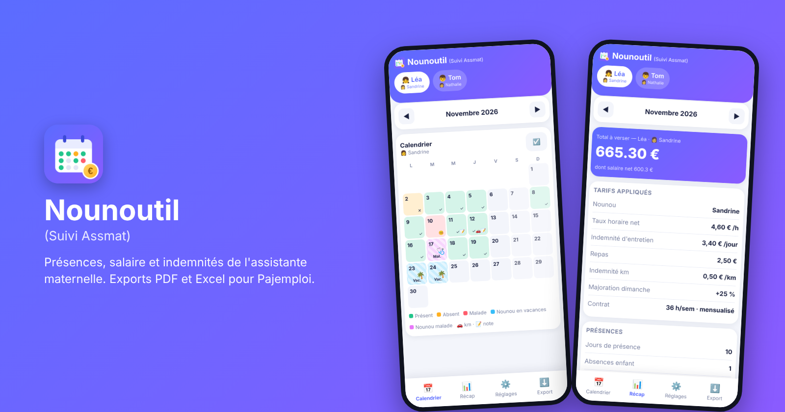
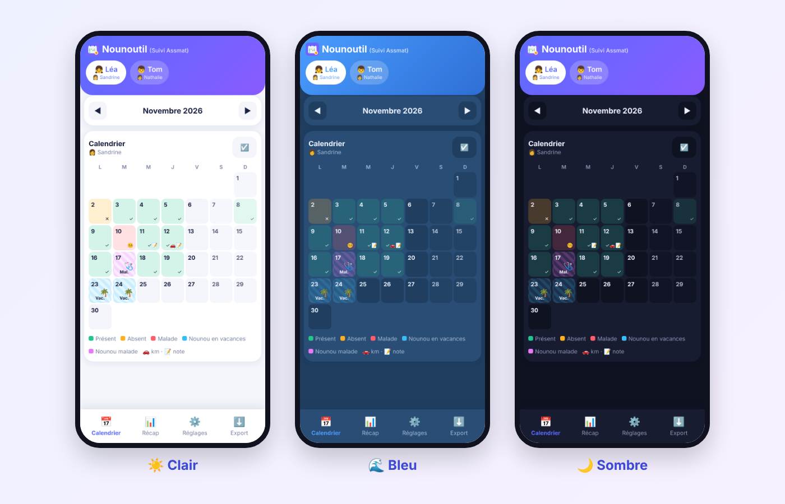

<div align="center">


# Nounoutil (Suivi Assmat)

**Présences, salaire et indemnités de l'assistante maternelle, en quelques touches.**
Exports PDF et Excel pour faciliter la déclaration **Pajemploi**.


[](https://github.com/florent6901/nounoutil/actions/workflows/docker-image.yml)


[Fonctionnalités](#-fonctionnalités) · [Démarrage rapide](#-démarrage-rapide) · [Installer comme application](#-installer-comme-application-pwa) · [Règles de calcul](#-règles-de-calcul) · [Sécurité](#-sécurité)



</div>

---

## ✨ Fonctionnalités

| | |
|---|---|
| 📅 **Calendrier** | Enfant *présent / absent / malade*, nounou *en vacances / malade*, heures, repas, km, commentaire par jour |
| ☑️ **Saisie rapide** | Sélection multiple de jours, raccourci « Lun-Ven » |
| 🔒 **Cohérence** | Nounou absente : aucun état possible pour l'enfant ce jour-là |
| 👨‍👩‍👧 **Multi-profils** | Plusieurs enfants, plusieurs nounous |
| 🕓 **Historique des contrats** | Un changement de nounou ou de tarif à une date donnée ne modifie jamais les mois passés |
| 📊 **Récap mensuel** | Heures normales / complémentaires / majorées, dimanches, salaire net et brut estimé, indemnités |
| 📄 **Exports** | PDF et Excel au mois, ou en lot (ZIP par enfant, mois et année) |
| 🎨 **Thèmes** | Clair, bleu marine, sombre |
| 📱 **Mobile d'abord** | Responsive, installable comme une application |

<div align="center">

</div>

## 🚀 Démarrage rapide

```bash
git clone https://github.com/florent6901/nounoutil.git
cd nounoutil
docker compose up -d --build
```

Ouvrir `http://<ip-du-serveur>:8080`, puis aller dans **Réglages** pour ajouter une nounou, puis un enfant avec son contrat.

Les données sont stockées dans `./data/asmat.db` (volume Docker) et survivent aux reconstructions.

**Sauvegarde** (cron) :

```bash
0 3 * * * cp /chemin/nounoutil/data/asmat.db /chemin/backup/asmat-$(date +\%F).db
```

**Mise à jour** :

```bash
git pull && docker compose up -d --build
```
**Structure du fichier docker-compose.yml**:
```yaml
services:
  nounoutil:
    build: .
    image: nounoutil:latest
    container_name: nounoutil
    ports: ["8080:8000"] # <= Modifier le port 8080 par un autre port
    volumes: ["./data:/data"]
    restart: unless-stopped
```

## 📲 Installer comme application (PWA)

Dans **Réglages → Application**, le bouton **📲 Installer** lance l'installation (Android) ou affiche les étapes à suivre (iPhone : Safari → Partager → *Sur l'écran d'accueil*).

> ⚠️ **Android / Chrome exige une adresse HTTPS** pour proposer « Installer l'application ». Sur `http://192.168.x.x:8080`, Chrome ne propose que « Créer un raccourci ». L'iPhone accepte l'ajout à l'écran d'accueil, même en HTTP.

Il suffit de placer un **reverse proxy HTTPS** devant l'application. Quatre solutions :

### Option 1 : Tailscale Serve (simple, sans nom de domaine)

[Tailscale Serve](https://tailscale.com/kb/1312/serve) agit comme un reverse proxy HTTPS, accessible uniquement depuis le réseau privé Tailscale (*tailnet*), avec un certificat valide pour le nom `*.ts.net`.

1. Activer **MagicDNS** et **HTTPS Certificates** dans la console d'administration Tailscale (page *DNS*).
2. Installer Tailscale sur le serveur **et** sur le téléphone (connecté au même compte).
3. Sur le serveur :

```bash
tailscale serve --bg 8080
```

L'application est alors disponible sur `https://<machine>.<tailnet>.ts.net`, y compris hors du domicile.

### Option 2 : Caddy (nom de domaine)

[Caddy](https://caddyserver.com/) obtient et renouvelle automatiquement un certificat Let's Encrypt. Il faut un nom de domaine pointant vers le serveur, et les ports 80 et 443 joignables depuis Internet (ou un challenge DNS pour un usage purement domestique).

```caddyfile
nounoutil.exemple.fr {
    reverse_proxy localhost:8080
}
```

### Option 3 : Traefik (environnement Docker)

[Traefik](https://traefik.io/) détecte les conteneurs via leurs labels. Prérequis : une instance Traefik avec un *certresolver* (ici `letsencrypt`) et un réseau Docker partagé (ici `proxy`). Le port interne de l'application est `8000`, la publication du port `8080` devient inutile.

```yaml
services:
  nounoutil:
    build: .
    restart: unless-stopped
    volumes: ["./data:/data"]
    networks: [proxy]
    labels:
      - traefik.enable=true
      - traefik.docker.network=proxy
      - traefik.http.routers.nounoutil.rule=Host(`nounoutil.exemple.fr`)
      - traefik.http.routers.nounoutil.entrypoints=websecure
      - traefik.http.routers.nounoutil.tls.certresolver=letsencrypt
      - traefik.http.services.nounoutil.loadbalancer.server.port=8000
networks:
  proxy:
    external: true
```

Un middleware `basicauth` peut s'ajouter pour protéger l'accès (voir [Sécurité](#-sécurité)).

### Option 4 : test sur un seul téléphone (sans HTTPS)

Dans Chrome Android, ouvrir `chrome://flags/#unsafely-treat-insecure-origin-as-secure`, activer l'option, ajouter l'adresse `http://IP:port`, relancer Chrome, puis menu ⋮ → **Installer l'application**. Réservé aux tests.

## 🧮 Règles de calcul

| Élément | Règle |
|---|---|
| Mensualisé | heures/semaine × semaines/an ÷ 12 × taux horaire net |
| Heures réelles | somme des heures de présence × taux horaire net |
| Heures complémentaires | au-delà du contrat, jusqu'à 45 h/semaine (mensualisé) |
| Heures majorées | au-delà de 45 h/semaine, majoration paramétrable (25 % par défaut) |
| Dimanche travaillé | heures du dimanche × taux horaire × majoration dimanche (0 % par défaut, à régler dans **Réglages → Rémunération**) |
| Nounou malade | jours déduits par défaut (mensualisé), désactivable dans **Réglages → Rémunération** |
| Enfant malade | déduit seulement si l'option « certificat médical » est activée |
| Brut estimé | net ÷ coefficient (0,7812 par défaut, modifiable) |
| Indemnités | entretien × jours de présence, repas × nombre de repas, km × taux/km |
| Mois à cheval sur deux contrats | calcul par période, mensualisation au prorata des jours calendaires |

> ⚠️ Les montants sont **indicatifs** et ne remplacent ni le contrat, ni la convention collective, ni les règles officielles. Toujours vérifier avant de déclarer sur Pajemploi. Ce projet n'est pas affilié à Pajemploi / URSSAF.

## 🔐 Sécurité

L'application n'a **pas d'authentification**. Ne pas exposer le port directement sur Internet : passer par un VPN (Tailscale, WireGuard) ou placer un reverse proxy avec mot de passe (Caddy, Traefik, Nginx) devant.

## 🗂️ Structure du projet

```
nounoutil/
├── app/
│   ├── app.py              # API Flask, calculs, exports PDF/Excel
│   └── static/             # interface (index.html), service worker, manifeste PWA, icônes
├── docs/                   # visuels du README
├── Dockerfile
├── docker-compose.yml
├── requirements.txt
├── CHANGELOG.md
├── LICENSE
└── README.md
```

## 🛠️ Développement local

```bash
python -m venv .venv && source .venv/bin/activate
pip install -r requirements.txt
cd app && DB=../data/asmat.db flask --app app run --debug
```

## 🔌 API (résumé)

`GET /api/state` · `GET /api/month?child=&ym=` · `POST /api/day` · `POST /api/nday` · `POST /api/child` · `GET /api/export/{pdf|xlsx}?child=&ym=` · `GET /api/bulk?children=&months=&fmt=`

## 🤝 Contribuer

Branches `feat/…`, `fix/…`, `docs/…` · messages de commit [Conventional Commits](https://www.conventionalcommits.org/fr/) (`feat: …`, `fix: …`) · versions `vMAJEUR.MINEUR.CORRECTIF`.

## 📄 Licence

[MIT](LICENSE)
